# SSO Direct-to-Game UI Analysis Documentation

## Overview

This document provides a comprehensive analysis of the required UI components and metadata for Single Sign-On (SSO) direct-to-game functionality in the Cocos Creator client. The analysis is based on the examination of prefab files, scene structures, and the SSO workflow documentation.

## Table of Contents

1. [UI Architecture Overview](#ui-architecture-overview)
2. [Splash Scene UI Components](#splash-scene-ui-components)
3. [Microsite Game Webview](#microsite-game-webview)
4. [Lobby Scene Integration](#lobby-scene-integration)
5. [Mini Games Panel](#mini-games-panel)
6. [SSO Authentication Flow UI](#sso-authentication-flow-ui)
7. [Game Launch Decision UI](#game-launch-decision-ui)
8. [Session Management UI](#session-management-ui)
9. [Responsive Design Requirements](#responsive-design-requirements)
10. [Implementation Guidelines](#implementation-guidelines)
11. [Error Handling UI](#error-handling-ui)
12. [Performance Considerations](#performance-considerations)

---

## UI Architecture Overview

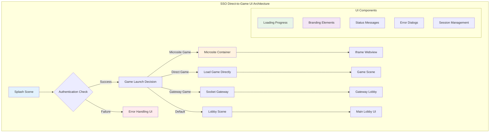

### UI Component Hierarchy

```
Root Canvas (1398x786)
├── Background Layer
│   └── Full-screen background (Black)
├── Main Splash Layer
│   ├── Loading Progress UI
│   ├── Branding Elements
│   └── Status Messages
├── Microsite Game Layer
│   └── Iframe Container (Hidden by default)
├── Dialog Layer
│   └── Error & Notification Dialogs
└── Overlay Layer
    └── Session Management UI
```

---

## Splash Scene UI Components

### Scene Structure Analysis

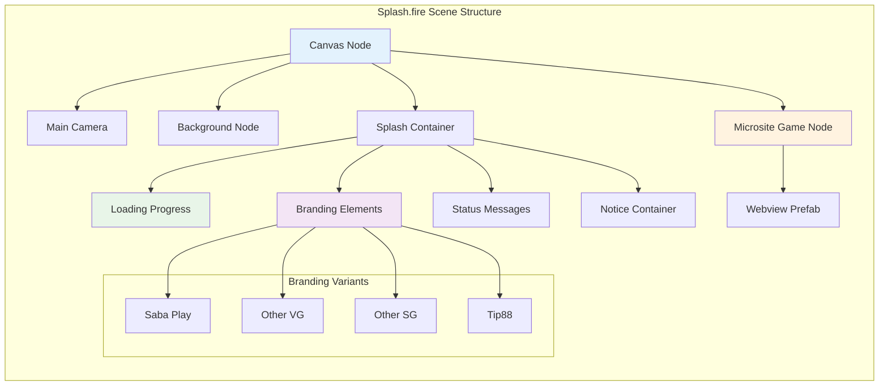

### Key UI Components

#### 1. **Loading Progress Elements**

```typescript
interface LoadingProgressUI {
    containerProgressBar: cc.Node; // Progress bar container
    percentResourceLoad: cc.Label; // Loading percentage text
    messageComp: RandomWaitingMessage; // Status message component
}
```

#### 2. **Branding Elements**

```typescript
interface BrandingUI {
    sloganSC1: cc.Node; // Saba Play variant 1
    sloganSC2: cc.Node; // Saba Play variant 2
    sloganSabaPlay: cc.Node; // Main Saba Play branding
    sloganOtherVG: cc.Node; // Other VG operator
    sloganOtherSG: cc.Node; // Other SG operator
    sloganTip88: cc.Node; // Tip88 operator
    iconTop: cc.Sprite; // Top operator icon
    iconBottom: cc.Sprite; // Bottom operator icon
}
```

#### 3. **Microsite Game Container**

```typescript
interface MicrositeContainerUI {
    nodeMicrositeGame: cc.Node; // Full-screen container
    prfMicrositeGame: cc.Prefab; // Webview prefab reference
    webview: CustomWebView; // Iframe component
}
```

### Scene Metadata

| Component        | Type      | Size        | Position | Properties        |
| ---------------- | --------- | ----------- | -------- | ----------------- |
| Canvas           | cc.Node   | 1398x786    | Center   | Design resolution |
| Background       | cc.Sprite | 1398x786    | (0,0)    | Black color       |
| Splash Container | cc.Node   | Full-screen | Center   | Widget layout     |
| Microsite Node   | cc.Node   | 1398x786    | Center   | Hidden by default |

---

## Microsite Game Webview

### Prefab Structure

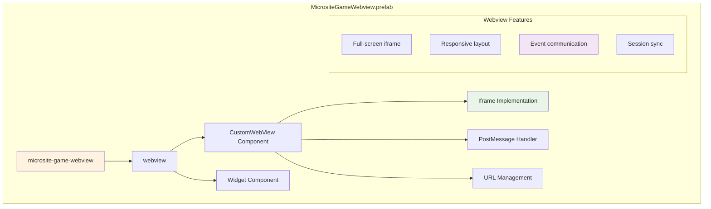

### Component Properties

```typescript
interface MicrositeWebviewUI {
    // Root container
    rootNode: {
        size: { width: 1398; height: 786 };
        anchorPoint: { x: 0.5; y: 0.5 };
        position: { x: 699; y: 393 };
    };

    // Webview component
    webview: {
        url: string;
        webviewEvents: string[];
        iframeId: "microsite";
    };

    // Widget layout
    widget: {
        alignMode: 1;
        alignFlags: 45;
        fullStretch: true;
    };
}
```

### Iframe Integration

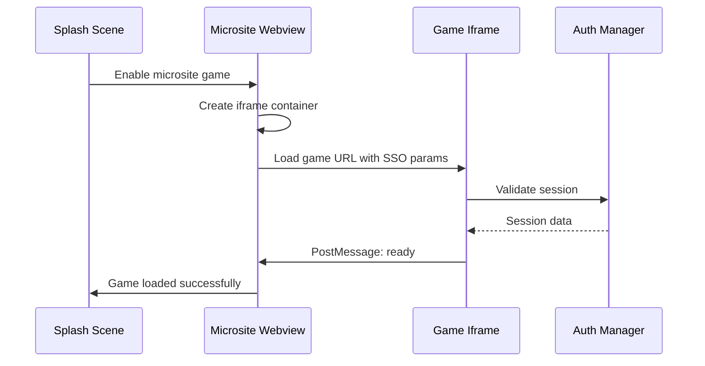

---

## Lobby Scene Integration

### Lobby UI Structure

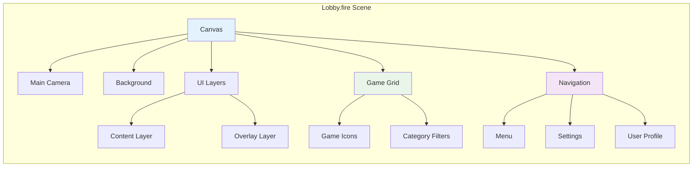

### SSO Integration Points

```typescript
interface LobbySSOIntegration {
  // SSO game launch handling
  onSignIn(): void {
    if (isSSOToGame) {
      loadLobby(false);
      openGameSSO();
    }
  };

  // Direct mode support
  handleDirectMode(): void {
    if (isDirectMode) {
      backToOperatorLobby();
    }
  };
}
```

---

## Mini Games Panel

### Panel Structure

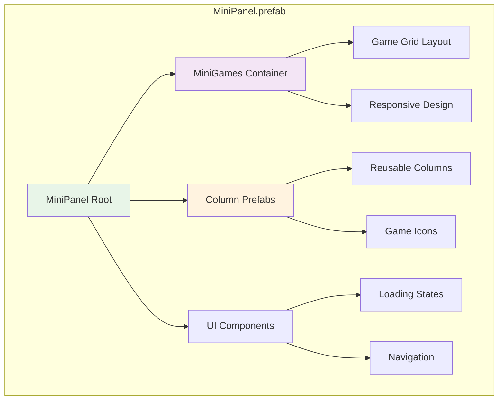

### Component Properties

| Component           | Size         | Layout      | Features          |
| ------------------- | ------------ | ----------- | ----------------- |
| MiniPanel Root      | 1398x786     | Full-screen | Responsive widget |
| MiniGames Container | Full-stretch | Grid layout | Game icon display |
| Column Prefabs      | Dynamic      | Reusable    | Modular design    |

---

## SSO Authentication Flow UI

### Authentication UI States

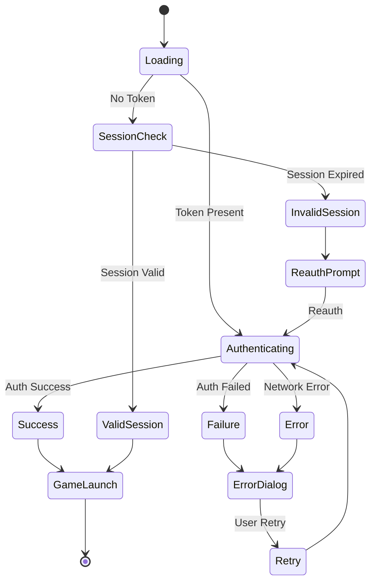

### UI Components for Each State

#### **Loading State**

```typescript
interface LoadingStateUI {
    progressBar: cc.Node;
    percentageLabel: cc.Label;
    loadingMessage: cc.Label;
    brandingElements: cc.Node[];
    spinner: cc.Node;
}
```

#### **Authenticating State**

```typescript
interface AuthenticatingStateUI {
    statusMessage: cc.Label;
    progressIndicator: cc.Node;
    cancelButton: cc.Button;
    timeoutWarning: cc.Node;
}
```

#### **Error State**

```typescript
interface ErrorStateUI {
    errorDialog: cc.Node;
    errorMessage: cc.Label;
    retryButton: cc.Button;
    helpLink: cc.Label;
    closeButton: cc.Button;
}
```

---

## Game Launch Decision UI

### Launch Decision Flow

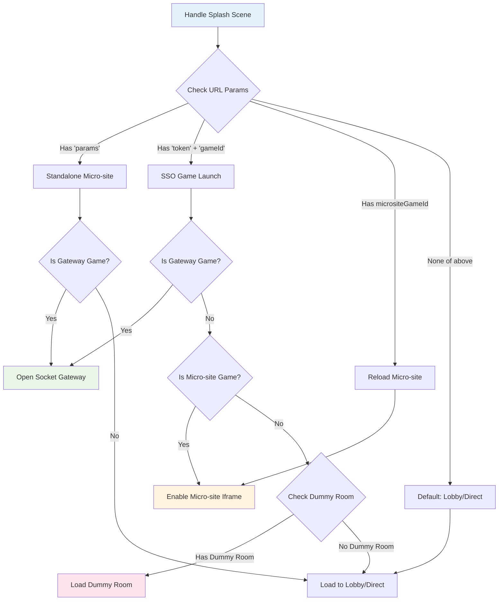

### UI Components for Each Launch Type

#### **Direct Game Launch**

```typescript
interface DirectGameLaunchUI {
    gameLoader: cc.Node;
    progressBar: cc.Node;
    gameIcon: cc.Sprite;
    loadingMessage: cc.Label;
    cancelButton: cc.Button;
}
```

#### **Microsite Game Launch**

```typescript
interface MicrositeGameLaunchUI {
    iframeContainer: cc.Node;
    loadingOverlay: cc.Node;
    webviewComponent: CustomWebView;
    backButton: cc.Button;
    sessionSync: cc.Node;
}
```

#### **Gateway Game Launch**

```typescript
interface GatewayGameLaunchUI {
    socketConnector: cc.Node;
    connectionStatus: cc.Label;
    lobbyLoader: cc.Node;
    gameList: cc.Node;
}
```

---

## Session Management UI

### Session Flow

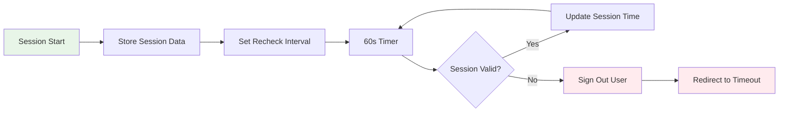

### Session UI Components

```typescript
interface SessionManagementUI {
    // Session timeout warning
    timeoutWarning: {
        dialog: cc.Node;
        countdownTimer: cc.Label;
        extendButton: cc.Button;
        logoutButton: cc.Button;
    };

    // Session refresh
    sessionRefresh: {
        refreshIndicator: cc.Node;
        statusMessage: cc.Label;
        progressBar: cc.Node;
    };

    // Balance updates
    balanceDisplay: {
        balanceLabel: cc.Label;
        updateAnimation: cc.Animation;
        currencyIcon: cc.Sprite;
    };
}
```

---

## Responsive Design Requirements

### Design Specifications

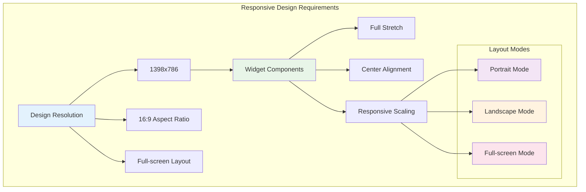

### Widget Configuration

```typescript
interface WidgetConfig {
    alignMode: 1; // Full stretch mode
    alignFlags: 45; // All sides aligned
    left: 0; // Left edge
    right: 0; // Right edge
    top: 0; // Top edge
    bottom: 0; // Bottom edge
    horizontalCenter: 0; // Center horizontally
    verticalCenter: 0; // Center vertically
}
```

### Anchor Point Strategy

| Component        | Anchor Point | Purpose              |
| ---------------- | ------------ | -------------------- |
| Canvas           | (0.5, 0.5)   | Center alignment     |
| Background       | (0.5, 0.5)   | Full-screen coverage |
| UI Elements      | (0.5, 0.5)   | Centered positioning |
| Iframe Container | (0.5, 0.5)   | Responsive scaling   |

---

## Implementation Guidelines

### Component Hierarchy

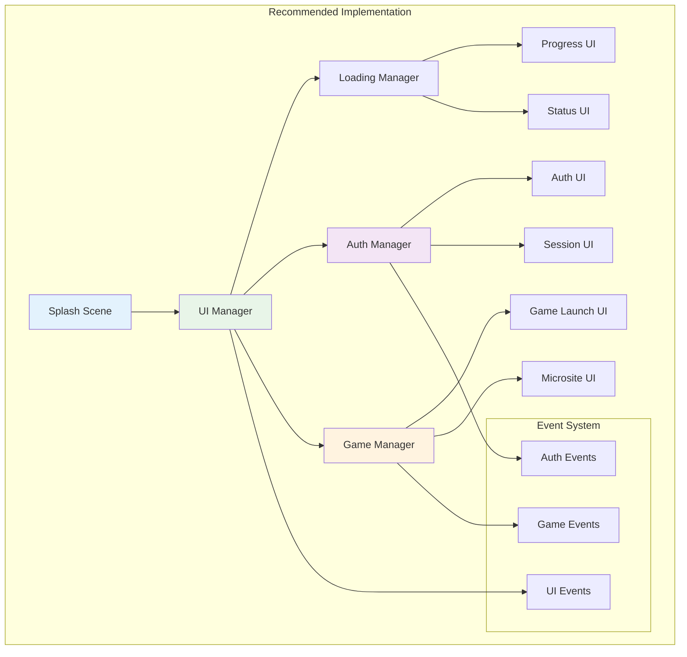

### State Management

```typescript
interface UIStateManagement {
    // Current UI state
    currentState: "loading" | "authenticating" | "gameLaunch" | "error";

    // State transitions
    transitionTo(newState: string): void;

    // UI updates
    updateProgress(progress: number): void;
    updateStatus(message: string): void;
    showError(error: Error): void;

    // Component visibility
    showComponent(component: string): void;
    hideComponent(component: string): void;
}
```

### Event Handling

```typescript
interface UIEventHandling {
    // SSO events
    onSSOSuccess(): void;
    onSSOFailure(error: Error): void;
    onSessionTimeout(): void;

    // Game launch events
    onGameLaunchStart(): void;
    onGameLaunchSuccess(): void;
    onGameLaunchFailure(error: Error): void;

    // User interaction
    onRetryClick(): void;
    onCancelClick(): void;
    onBackToLobby(): void;
}
```

---

## Error Handling UI

### Error UI Flow

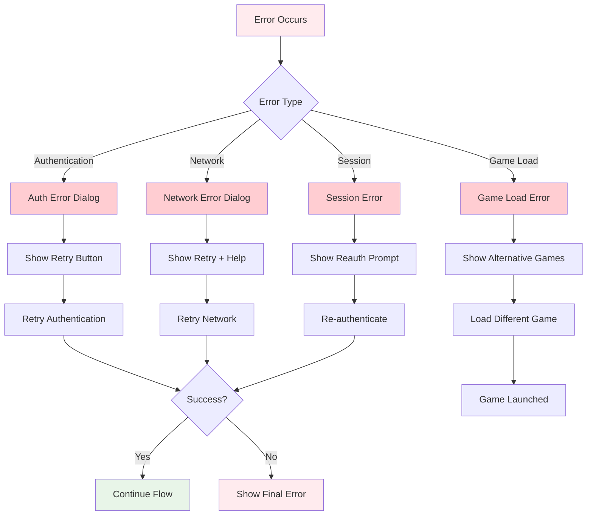

### Error Dialog Components

```typescript
interface ErrorDialogUI {
    // Dialog container
    dialog: {
        background: cc.Node;
        content: cc.Node;
        closeButton: cc.Button;
    };

    // Error content
    errorContent: {
        icon: cc.Sprite;
        title: cc.Label;
        message: cc.Label;
        details: cc.Label;
    };

    // Action buttons
    actions: {
        retryButton: cc.Button;
        helpButton: cc.Button;
        cancelButton: cc.Button;
        backToLobbyButton: cc.Button;
    };

    // Animation
    animation: {
        showAnimation: cc.Animation;
        hideAnimation: cc.Animation;
    };
}
```

### Error Message Templates

| Error Type            | Title              | Message                                                        | Actions           |
| --------------------- | ------------------ | -------------------------------------------------------------- | ----------------- |
| Authentication Failed | "Login Failed"     | "Unable to authenticate. Please try again."                    | Retry, Help       |
| Network Error         | "Connection Lost"  | "Network connection interrupted. Please check your internet."  | Retry, Help       |
| Game Load Error       | "Game Unavailable" | "This game is currently unavailable. Please try another game." | Alternative Games |
| Session Expired       | "Session Expired"  | "Your session has expired. Please log in again."               | Re-authenticate   |

---

## Performance Considerations

### Loading Optimization

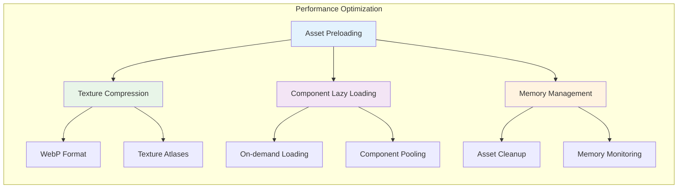

### Performance Metrics

| Metric            | Target      | Measurement              |
| ----------------- | ----------- | ------------------------ |
| Initial Load Time | < 3 seconds | Asset compilation + auth |
| Scene Transition  | < 500ms     | Scene loading time       |
| UI Responsiveness | < 100ms     | Button click response    |
| Memory Usage      | < 200MB     | Peak memory consumption  |
| Frame Rate        | 60 FPS      | Smooth animations        |

### Optimization Strategies

```typescript
interface PerformanceOptimization {
    // Asset management
    preloadCriticalAssets(): Promise<void>;
    unloadUnusedAssets(): void;

    // Component optimization
    useObjectPooling(): void;
    implementLazyLoading(): void;

    // Memory management
    monitorMemoryUsage(): void;
    cleanupResources(): void;

    // UI optimization
    useTextureAtlases(): void;
    implementCulling(): void;
}
```

---

## Conclusion

This comprehensive UI analysis provides the complete framework for implementing SSO direct-to-game functionality in the Cocos Creator client. The documented components, flows, and requirements ensure:

1. **Seamless User Experience**: Smooth transitions between authentication and game launch
2. **Robust Error Handling**: Comprehensive error states with user-friendly recovery options
3. **Responsive Design**: Full-screen responsive layout across different devices
4. **Performance Optimization**: Efficient loading and resource management
5. **Maintainable Architecture**: Clear component hierarchy and state management

The implementation should follow the documented UI patterns and component structures to ensure consistency and reliability across all SSO scenarios.

---

## Appendix

### Component UUIDs

| Component            | UUID                                 | File                        |
| -------------------- | ------------------------------------ | --------------------------- |
| MicrositeGameWebview | 7b901614-488b-413f-a2be-b1a7a3de4036 | MicrositeGameWebview.prefab |
| Splash Scene         | 2dbb7549-feda-42b6-a6a9-86608310bcaf | Splash.fire                 |
| Lobby Scene          | 2d2f792f-a40c-49bb-a189-ed176a246e49 | Lobby.fire                  |

### File References

-   `assets/splash/views/Splash.fire` - Main splash scene
-   `assets/splash/views/MicrositeGameWebview.prefab` - Microsite game container
-   `assets/lobby/main/views/Lobby.fire` - Lobby scene
-   `assets/mini-games-panel/views/MiniPanel.prefab` - Mini games panel

### Related Documentation

-   [SSO Workflow Documentation](./SSO_WORKFLOW_DOCUMENTATION.md)
-   [Game Configuration Guide](./GAME_CONFIGURATION.md)
-   [Authentication Manager Documentation](./AUTH_MANAGER.md)
