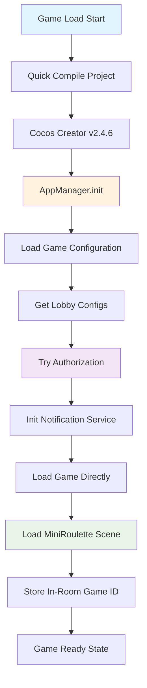
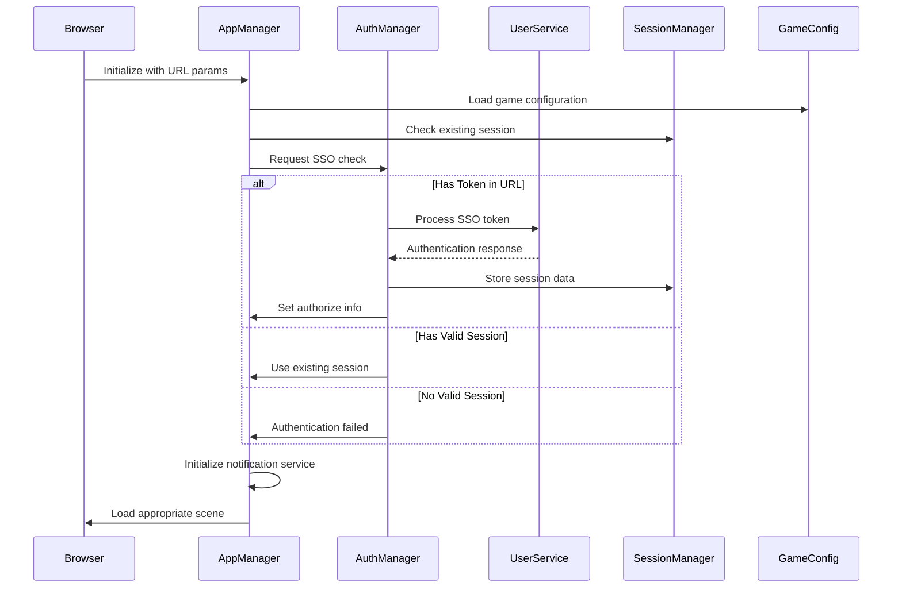
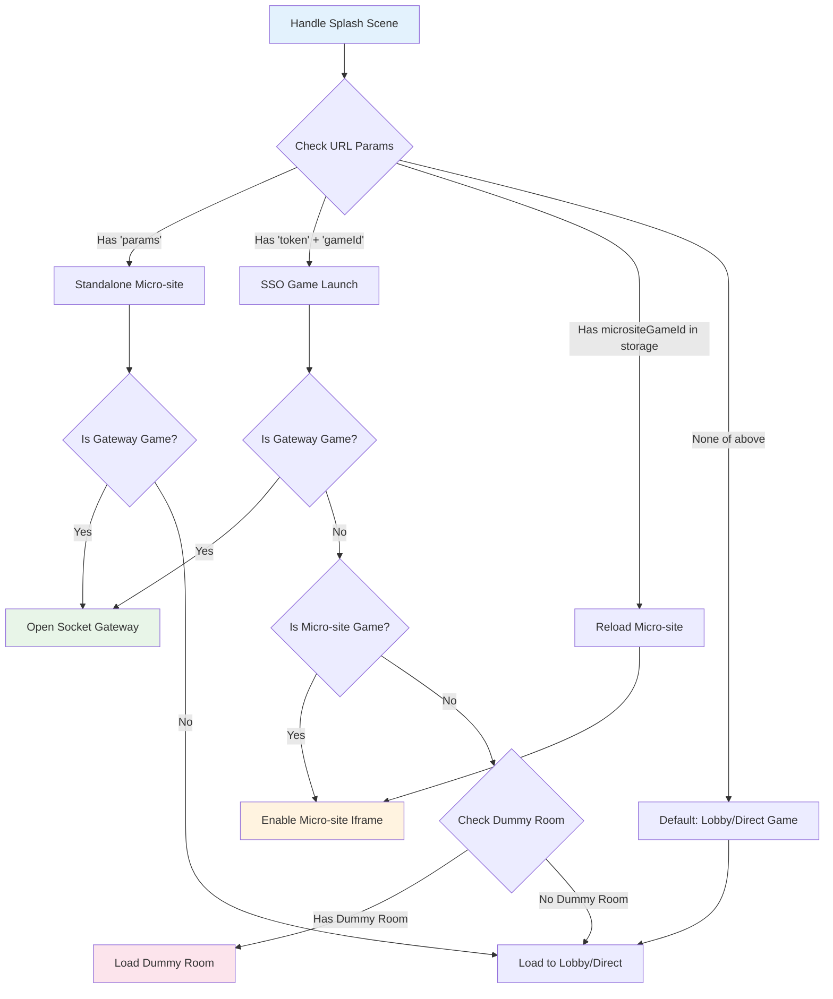
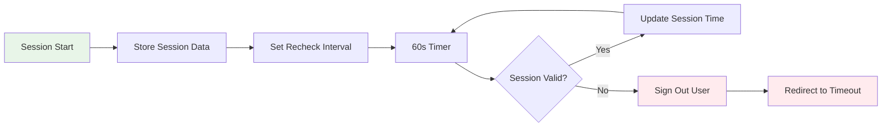
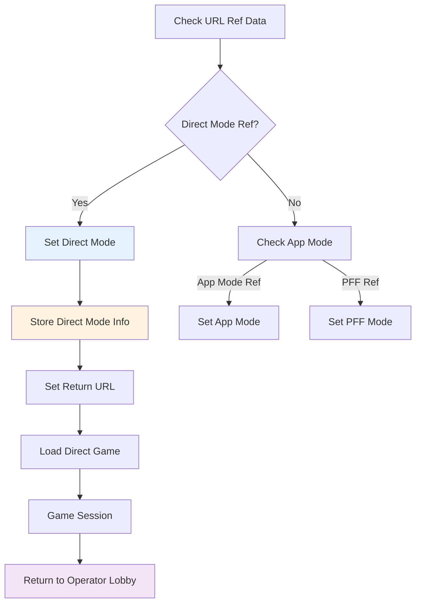

# SSO Workflow Documentation

## Overview

This document describes the Single Sign-On (SSO) workflow for the single-player Cocos client, including authentication, session management, and game launch processes.

## Table of Contents

1. [Application Initialization Flow](#application-initialization-flow)
2. [SSO Authentication Flow](#sso-authentication-flow)
3. [Game Launch Decision Tree](#game-launch-decision-tree)
4. [Session Management Flow](#session-management-flow)
5. [Direct Mode Flow](#direct-mode-flow)
6. [Key Components Analysis](#key-components-analysis)
7. [Log Analysis](#log-analysis)
8. [Common SSO Scenarios](#common-sso-scenarios)
9. [Troubleshooting Guide](#troubleshooting-guide)

---

## Application Initialization Flow



### Initialization Steps

1. **Project Compilation**: Cocos Creator compiles the project (~763ms)
2. **AppManager Initialization**: Initialize URL parameters, language, audio settings
3. **Game Configuration**: Load game-specific configurations
4. **Lobby Configuration**: Load lobby settings and resources
5. **Authorization Check**: Verify user authentication status
6. **Notification Service**: Initialize real-time notifications
7. **Scene Loading**: Load appropriate game scene or lobby

---

## SSO Authentication Flow



### Authentication Process

1. **URL Parameter Analysis**: Check for token, gameId, params, ref data
2. **Session Validation**: Verify existing session expiration (19.8 minutes)
3. **Token Processing**: If token exists, authenticate via UserService
4. **Session Storage**: Store authenticated session data
5. **Authorization Setup**: Set global auth data and chip settings
6. **Recheck-in Setup**: Initialize periodic session validation

---

## Game Launch Decision Tree



### Launch Scenarios

1. **Standalone Micro-site**: Direct access with params in URL
2. **SSO Game Launch**: Token-based authentication with specific game
3. **Micro-site Reload**: Resume micro-site game from storage
4. **Gateway Game**: Socket-based multiplayer games
5. **Dummy Room**: Mini-games with room-based gameplay
6. **Default Flow**: Standard lobby or direct game launch

---

## Session Management Flow



### Session Management

-   **Session Timeout**: 19.8 minutes
-   **Recheck Interval**: Every 60 seconds
-   **Auto Sign-out**: Automatic logout on session expiration
-   **Balance Updates**: Periodic balance synchronization

---

## Direct Mode Flow



### Direct Mode Features

-   **Direct Game Access**: Skip lobby, go directly to specific game
-   **Return URL**: Automatic return to operator platform
-   **Session Persistence**: Maintain direct mode across sessions
-   **Operator Integration**: Seamless integration with operator platforms

---

## Key Components Analysis

### AppManager.ts 🔧

**Primary Role**: Central coordinator for application state and authentication flow

**Key Functions**:

-   `init()`: Initialize URL params, language, audio settings
-   `ssoAndAuthorize()`: Handle SSO and user authorization process
-   `handleAppMode()`: Process direct mode, app mode, PFF settings
-   `authorizeByUserService()`: Authenticate via UserService with retry logic
-   `handleCurrencyGroup()`: Initialize currency-specific resources

**Console Logs**: `🔧 [AppManager]`

### AuthManager.js 🔐

**Primary Role**: Handle SSO authentication and session management

**Key Functions**:

-   `checkSSO()`: Main SSO validation logic and token processing
-   `verifySession()`: Check session expiration (19.8 minutes timeout)
-   `reCheckIn()`: Periodic session validation every 60 seconds
-   `setAuthorizeInfo()`: Set global auth data and chip settings
-   `updateUserBalance()`: Synchronize user balance data

**Console Logs**: `🔐 [AuthManager]`

### Splash.ts 🎮

**Primary Role**: Scene routing and game launch coordination

**Key Functions**:

-   `handleSplashScene()`: Route to appropriate game/scene based on URL params
-   `handleAuthorization()`: Coordinate authentication flow
-   `enableMicrositeGameIframe()`: Load microsite games in iframe
-   `handleGatewayGame()`: Handle socket-based multiplayer games
-   `handleOpenDummyRoom()`: Manage mini-game room sessions

**Console Logs**: `🎮 [Splash]`

### MicrositeGameWebview.ts 🌐

**Primary Role**: Handle microsite game iframe interactions and session sync

**Key Functions**:

-   `getMicrositeGameQueryString()`: Build iframe URL with authentication params
-   `updateSession()`: Synchronize session data with microsite game
-   `loadLobbyScene()`: Return to main lobby from microsite
-   `onClickJoinGame()`: Handle game joining from microsite

**Console Logs**: `🌐 [MicrositeGameWebView]`

---

## Log Analysis

Based on the provided logs, here's the actual workflow that occurred:

```
load __quick_compile_project__: 763.134033203125 ms
__quick_compile__.js:244 eval __quick_compile_project__ : 1540 files: 669.5068359375 ms
CCGame.js:393 Cocos Creator v2.4.6
assets\managers\AppManager.ts:79 AppManager init  134
assets\configs\GameConfigurations.ts:39 Try load configuration  1
assets\lobby\main\view-models\LobbyManager.ts:73 Try get lobby configs: 1
assets\managers\AppManager.ts:288 Try authorizeByUserService  1
assets\managers\AppManager.ts:92 initNotificationService -----------------------------------
assets\splash\view-models\MainSplash.ts:206 Main Splash : loadGameDirectly  134
CCDirector.js:539 LoadScene MiniRoulette: 210.388916015625 ms
assets\common\auth\SessionManager.ts:91 --------------------- storeInRoomGameId 134
assets\games\_base_new\view-models\MiniGameBase.ts:280 emitter null for  PlayerModel:HAS_PLAYER
assets\games\_base_new\view-models\MiniGameBase.ts:280 emitter null for  PlayerModel:HAS_PLAYERS
assets\games\_base_new\view-models\MiniGameBase.ts:280 emitter null for  PlayerModel:REMOVE_PLAYER
assets\games\_solo_game\solo-game.ts:62 ----state ---  ready
assets\games\__roulette-s\roulette-s.ts:83 onChangedBetChip 100
```

### Log Interpretation

1. **Project Compilation**: Successfully compiled 1540 files in ~763ms
2. **AppManager Initialization**: Initialized with game ID 134 (MiniRoulette)
3. **Game Configuration**: Loaded configuration for game ID 1
4. **Authorization**: Attempted authorization (retry attempt #1)
5. **Direct Launch**: Bypassed lobby, loaded game directly
6. **Scene Loading**: MiniRoulette scene loaded in ~210ms
7. **Game Session**: Stored in-room game ID 134
8. **Game State**: Game entered "ready" state
9. **User Interaction**: User placed a 100 chip bet

### Scenario Analysis

This log sequence indicates a **Direct Game Launch** scenario:

-   User was already authenticated (no SSO token processing visible)
-   Went directly to MiniRoulette (game ID 134) without lobby
-   Game loaded successfully and user could place bets
-   This suggests either a session resume or direct mode activation

---

## Common SSO Scenarios

### 1. Fresh Login with Token

```
URL: ?token=abc123&gameId=134
Flow: Token Auth → Validate → Load Game 134
```

### 2. Direct Game Launch

```
URL: ?token=abc123&gameId=134&ref=d_direct
Flow: Token Auth → Direct Mode → Load Game 134
```

### 3. Session Resume

```
URL: (no token, valid session in storage)
Flow: Session Check → Resume Last Location
```

### 4. Microsite Game

```
URL: ?token=abc123&gameId=500
Flow: Token Auth → Iframe → Microsite Game
```

### 5. Gateway Game

```
URL: ?token=abc123&gameId=200
Flow: Token Auth → Socket Connection → Gateway Game
```

### 6. Standalone Microsite

```
URL: ?params=encoded_session_data&gameId=500
Flow: Decode Params → Load Microsite → Iframe
```

---

## Troubleshooting Guide

### Common Issues

#### 1. Authentication Failures

**Symptoms**: User stuck on splash screen, authorization errors
**Debug Steps**:

-   Check browser console for `🔐 [AuthManager]` logs
-   Verify token validity and expiration
-   Check network connectivity to auth service
-   Review session storage for corrupted data

#### 2. Game Loading Issues

**Symptoms**: Game fails to load, scene transition errors
**Debug Steps**:

-   Check `🎮 [Splash]` logs for scene routing decisions
-   Verify game configuration loading
-   Check iframe creation for microsite games
-   Review socket connection for gateway games

#### 3. Session Timeout Issues

**Symptoms**: Unexpected logouts, session expiration errors
**Debug Steps**:

-   Monitor `🔐 [AuthManager]` recheck-in logs
-   Verify session timeout settings (19.8 minutes)
-   Check system clock synchronization
-   Review network connectivity during recheck-in

#### 4. Direct Mode Problems

**Symptoms**: Not returning to operator platform, direct mode not working
**Debug Steps**:

-   Check `🔧 [AppManager]` direct mode logs
-   Verify ref data in URL parameters
-   Check return URL configuration
-   Review direct mode storage persistence

### Debug Commands

Add these console commands to debug specific issues:

```javascript
// Check current session
console.log("Current Session:", sessionManager.getSession());

// Check direct mode status
console.log("Direct Mode:", appManager.isDirectMode);

// Check authorization status
console.log("Authorized:", appManager.authorized);

// Check URL parameters
console.log("URL Params:", Object.fromEntries(new URLSearchParams(window.location.search)));

// Force session refresh
sessionManager.removeSession();
location.reload();
```

### Performance Monitoring

Monitor these key metrics:

-   **Compilation Time**: Should be < 1000ms
-   **Scene Load Time**: Should be < 500ms
-   **Authorization Time**: Should be < 3000ms
-   **Session Recheck**: Every 60 seconds
-   **Session Timeout**: 19.8 minutes

---

## Conclusion

The SSO workflow is designed to provide seamless authentication and game access across multiple scenarios. The comprehensive logging system helps track the entire flow from initialization to game launch, making it easier to debug issues and optimize performance.

For additional support or questions about the SSO implementation, refer to the component-specific documentation or contact the development team.
