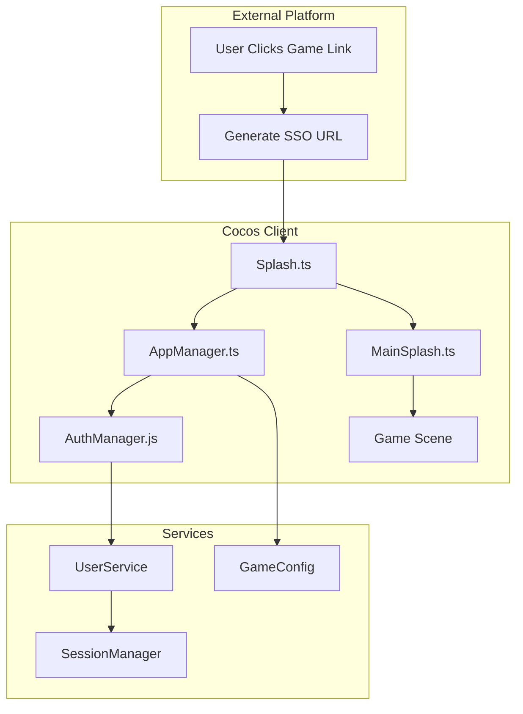
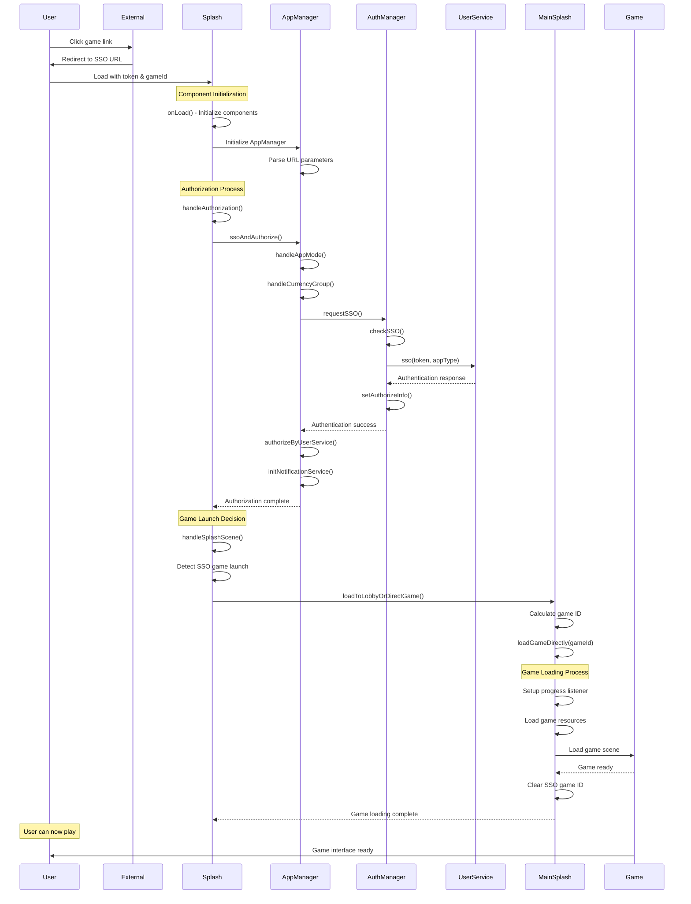
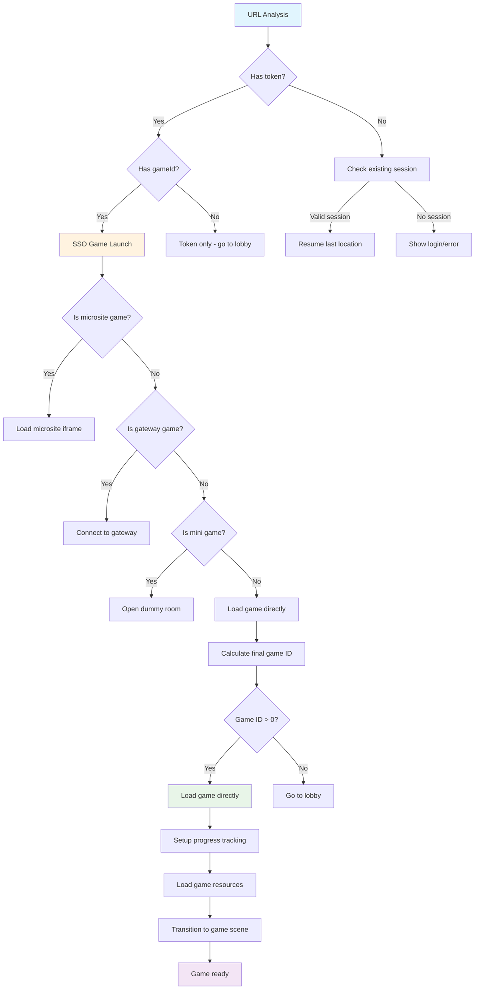

# SSO Direct Game Flow Documentation

## Overview

This document describes the **Single Sign-On (SSO) Direct Game** flow, which allows users to access specific games directly from external platforms without going through the lobby. This is a key feature for seamless integration with operator platforms.

## Table of Contents

1. [Flow Overview](#flow-overview)
2. [URL Parameters](#url-parameters)
3. [Component Architecture](#component-architecture)
4. [Detailed Flow Diagram](#detailed-flow-diagram)
5. [Decision Tree](#decision-tree)
6. [Authentication Flow](#authentication-flow)
7. [Game Loading Process](#game-loading-process)
8. [Performance Metrics](#performance-metrics)
9. [Error Handling](#error-handling)
10. [Testing Scenarios](#testing-scenarios)

---

## Flow Overview

The SSO Direct Game flow enables users to:

-   **Skip the lobby** entirely
-   **Load directly** into a specific game
-   **Maintain session** across external platform integration
-   **Return seamlessly** to the operator platform

### Key Benefits

-   ⚡ **Faster Access**: Direct game loading (3-4 seconds vs 10+ seconds with lobby)
-   🔗 **Seamless Integration**: No context switching between platforms
-   🎯 **Targeted Experience**: Users go straight to their intended game
-   🔐 **Secure Authentication**: Token-based SSO with session management

---

## URL Parameters

### Required Parameters

| Parameter | Type   | Description                              | Example                                |
| --------- | ------ | ---------------------------------------- | -------------------------------------- |
| `token`   | string | SSO authentication token                 | `6613c125-d37d-4217-b254-54cc38b5b509` |
| `gameId`  | number | Target game identifier                   | `134`                                  |
| `appType` | number | Application type (1=SabaApp, 5=SabaClub) | `1`                                    |

### Optional Parameters

| Parameter | Type   | Description                    | Example    |
| --------- | ------ | ------------------------------ | ---------- |
| `lang`    | string | Language preference            | `vi-VN`    |
| `op`      | string | Operator identifier            | `VG`       |
| `cg`      | string | Currency group                 | `Cash_INH` |
| `ref`     | string | Reference data for direct mode | `d_direct` |

### Example URL

```
http://localhost:7456?token=6613c125-d37d-4217-b254-54cc38b5b509&lang=vi-VN&appType=1&gameId=134&op=VG&cg=Cash_INH
```

---

## Component Architecture



### Component Responsibilities

#### 🎮 **Splash.ts**

-   **Primary Role**: Scene routing and flow coordination
-   **Key Functions**:
    -   URL parameter analysis
    -   SSO game launch detection
    -   Component delegation
    -   Error handling

#### 🔧 **AppManager.ts**

-   **Primary Role**: Application state management
-   **Key Functions**:
    -   SSO authentication coordination
    -   Session management
    -   Game configuration loading
    -   Direct mode handling

#### 🔐 **AuthManager.js**

-   **Primary Role**: SSO authentication processing
-   **Key Functions**:
    -   Token validation
    -   Session creation
    -   User data setup
    -   Authorization info setting

#### 🎯 **MainSplash.ts**

-   **Primary Role**: Game loading and progress display
-   **Key Functions**:
    -   Progress tracking
    -   Direct game loading
    -   UI state management
    -   Scene transition

---

## Detailed Flow Diagram



---

## Decision Tree



---

## Authentication Flow

### 1. Token Processing

```typescript
// AuthManager.js - checkSSO()
if (urlParams.has("token")) {
    console.log("🔐 [AuthManager] Token found in URL, processing SSO token");
    checkHasTokenWithPromise(urlParams, onSuccessFunc, resolve, reject);
}
```

### 2. UserService Authentication

```typescript
// UserService.getInstance().auth.sso(token, appType)
UserService.getInstance()
    .auth.sso(urlParams.get("token"), getAppType(urlParams))
    .then((response) => {
        if (response.isAuthenticated) {
            setAuthorizeInfo(response);
            sessionManager.storeSessionData(response);
            resolve(true);
        }
    });
```

### 3. Session Management

```typescript
// AuthManager.js - setAuthorizeInfo()
export function setAuthorizeInfo(session) {
    window.authData = session;
    getChipSetting();
    sentryLogger.setUser(session);
}
```

---

## Game Loading Process

### 1. Game ID Calculation

```typescript
// MainSplash.ts - loadToLobbyOrDirectGame()
const finalGameId = gameId || 0;

if (finalGameId > 0) {
    console.log("🎯 [MainSplash] 🎮 Loading game directly:", finalGameId);
    this.loadGameDirectly(finalGameId);
} else {
    console.log("🎯 [MainSplash] 🏠 Going to lobby");
    cc.director.loadScene("Lobby");
}
```

### 2. Progress Tracking

```typescript
// MainSplash.ts - Progress listener
this.progressListener = (progress, total) => {
    const percentage = Math.round((progress / total) * 100);
    console.log("🎯 [MainSplash] Game loading progress:", {
        progress,
        total,
        percentage
    });
    this.updateProgress(percentage);
};
```

### 3. Scene Transition

```typescript
// MainSplash.ts - loadGameDirectly()
cc.director.loadScene(gameSceneName, (error) => {
    if (!error) {
        console.log("🎯 [MainSplash] ✅ Game opened successfully");
        this.clearSSOGameId();
    }
});
```

---

## Performance Metrics

### Timing Breakdown

| Operation               | Duration | Description               |
| ----------------------- | -------- | ------------------------- |
| **Project Compilation** | ~710ms   | Cocos Creator compilation |
| **AppManager Init**     | ~2ms     | URL parsing and setup     |
| **SSO Authentication**  | ~46ms    | Token processing          |
| **Authorization**       | ~156ms   | Complete auth flow        |
| **Game Loading**        | ~3.5s    | Resource loading          |
| **Scene Transition**    | ~183ms   | Scene change              |
| **Total Time**          | ~4.5s    | End-to-end flow           |

### Key Performance Indicators

-   ✅ **SSO Authentication**: < 100ms
-   ✅ **Authorization Process**: < 200ms
-   ✅ **Game Loading**: < 5s
-   ✅ **Scene Transition**: < 200ms

---

## Error Handling

### 1. Authentication Failures

```typescript
// AppManager.ts - Retry logic
if (this.authorizeRetryCount < this.maxAuthorizeRetryCount) {
    this.authorizeRetryCount++;
    const retryDelay = this.authorizeRetryDelay * this.authorizeRetryCount;
    await new Promise((resolve) => setTimeout(resolve, retryDelay));
    return this.authorizeByUserService();
}
```

### 2. Game Loading Errors

```typescript
// MainSplash.ts - Error handling
cc.director.loadScene(gameSceneName, (error) => {
    if (error) {
        console.error("🎯 [MainSplash] ❌ Cannot load game directly:", gameId, error);
        this.handleGameLoadError(error);
    }
});
```

### 3. Session Timeout

```typescript
// AuthManager.js - Session verification
function verifySession(session) {
    const differenceInMinutes = Math.abs(now - lastRecheckIn) / (1000 * 60);
    return differenceInMinutes > sessionExpiredTimeoutMinutes; // 19.8 minutes
}
```

---

## Testing Scenarios

### 1. Happy Path

**URL**: `?token=valid&gameId=134&appType=1`

**Expected Flow**:

1. ✅ SSO authentication succeeds
2. ✅ Game 134 loads directly
3. ✅ User can place bets
4. ✅ Session persists

### 2. Invalid Token

**URL**: `?token=invalid&gameId=134&appType=1`

**Expected Flow**:

1. ❌ SSO authentication fails
2. 🔄 Retry mechanism activates
3. ❌ Max retries reached
4. 🚫 Show error message

### 3. Missing Game ID

**URL**: `?token=valid&appType=1`

**Expected Flow**:

1. ✅ SSO authentication succeeds
2. 🏠 Redirect to lobby
3. ✅ User can select games

### 4. Session Resume

**URL**: `?gameId=134` (no token, valid session)

**Expected Flow**:

1. ✅ Use existing session
2. ✅ Game 134 loads directly
3. ✅ Faster loading (no auth)

### 5. Direct Mode

**URL**: `?token=valid&gameId=134&ref=d_direct`

**Expected Flow**:

1. ✅ SSO authentication succeeds
2. ✅ Direct mode activated
3. ✅ Game 134 loads directly
4. 🔄 Return URL saved for later

---

## Console Log Analysis

### Key Log Patterns

#### 🔐 **Authentication Success**

```
🔐 [AuthManager] Starting SSO check...
🔐 [AuthManager] Token found in URL, processing SSO token
🔐 [AuthManager] SSO authentication successful
🔧 [AppManager] ===== requestSSO completed (success) in 46 ms =====
```

#### 🎮 **Game Launch Detection**

```
🎮 [Splash] 🔐 SSO game launch check: {isSSOGameLaunch: true, hasToken: true, hasGameId: true, gameId: 134, isGameIdValid: true}
🎮 [Splash] 🚀 Processing SSO game launch for game ID: 134
```

#### 🎯 **Direct Game Loading**

```
🎯 [MainSplash] 🎮 Loading game directly: 134
🎯 [MainSplash] Game loading progress: {progress: 302, total: 303, percentage: 100}
🎯 [MainSplash] ✅ Game opened successfully
```

#### ⚡ **Performance Metrics**

```
🔧 [AppManager] ===== ssoAndAuthorize completed in 156 ms =====
🎮 [Splash] ===== handleAuthorization completed (success) in 178 ms =====
🎯 [MainSplash] ===== loadGameDirectly completed in 3508 ms =====
```

---

## Troubleshooting Guide

### Common Issues

#### 1. **Authentication Stuck at 1ms**

**Symptoms**: `===== requestSSO completed (failed) in 1 ms =====`

**Cause**: Promise handling issue in AuthManager.checkSSO()

**Solution**: Ensure checkSSO() returns a Promise and properly handles async operations

#### 2. **Game Loading Fails**

**Symptoms**: Progress stops or scene transition fails

**Cause**: Missing game resources or invalid game ID

**Solution**:

-   Verify game configuration exists
-   Check game ID validity
-   Ensure all game resources are available

#### 3. **Session Timeout**

**Symptoms**: Unexpected logout during gameplay

**Cause**: Session expired (19.8 minutes timeout)

**Solution**: Implement proper session refresh or re-authentication

#### 4. **Direct Mode Not Working**

**Symptoms**: Not returning to operator platform

**Cause**: Missing return URL or direct mode configuration

**Solution**: Verify ref parameter and return URL setup

### Debug Commands

```javascript
// Check current session
console.log("Session:", sessionManager.getSession());

// Check authentication status
console.log("Auth Data:", window.authData);

// Check URL parameters
console.log("URL Params:", Object.fromEntries(new URLSearchParams(window.location.search)));

// Check game configuration
console.log("Game Config:", GameConfigurations.getGameConfiguration(gameId));

// Force session refresh
sessionManager.removeSession();
location.reload();
```

---

## Conclusion

The SSO Direct Game flow provides a seamless, fast, and secure way for users to access specific games directly from external platforms. The comprehensive logging system and error handling ensure reliable operation and easy debugging.

### Key Success Factors

1. **Proper Promise Handling**: Ensures async operations complete correctly
2. **Comprehensive Logging**: Provides visibility into the entire flow
3. **Error Recovery**: Retry mechanisms and fallback scenarios
4. **Performance Optimization**: Fast authentication and efficient game loading
5. **Session Management**: Reliable state persistence across operations

### Future Enhancements

-   **Caching**: Implement game resource caching for faster subsequent loads
-   **Progressive Loading**: Load critical resources first for better perceived performance
-   **Analytics**: Track user journey and performance metrics
-   **A/B Testing**: Test different loading strategies for optimization

---

_This document covers the complete SSO Direct Game flow implementation and should be updated as the system evolves._
